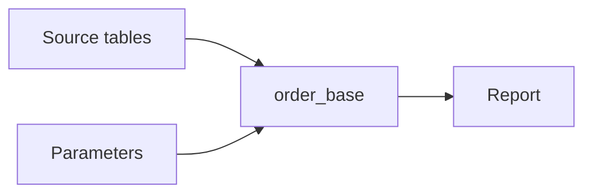
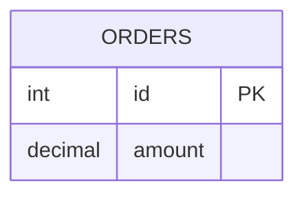

# Help a reader understand SQL

Use a **flowchart overview**, backed by one ER definition catalogue. ER describes the
schema; it is not the query's picture. Copy the shape of
`examples/maps/query-expansion.md`. What the reader understands, and the viewer's
behaviour, are in the "SQL query pictures" section of `docs/map-format.md`.

You write the meaningful overview, the shared schema and the mappings. The viewer reads
the original SQL and builds the query's insides. Do not draw clauses or columns by hand.

## Keep the SQL as written

Put the original query in one fenced `sql` block. Never rewrite it to fit: no synthetic
PARAMS table or CROSS JOIN, no dropped predicate, no IN turned into an equality, no EXISTS
turned into a JOIN. A picture of a changed query cannot help the reader check their query.

Schema details come from inspected definitions or the supplied schema. Declare each
physical table and its columns once; aliases and CTE outputs are not extra tables.
Unknown types, keys and cardinality stay unknown. Do not turn an explanation request into
unsolicited optimization or correctness findings.

## Write the map

````markdown
# Order report



## Query: Orders

#### Query options
- Schema: #definitions
- Schema visibility: hidden
- Into: report
- Sources: sources
- Binds: params

#### Scopes
- order_base: base

#### Physical names
- sales.orders: ORDERS

```sql oracle
WITH order_base AS (
  SELECT o.id, o.amount FROM sales.orders o WHERE o.amount >= :minimum
)
SELECT b.id, b.amount FROM order_base b
```

## Definitions


````

- **Overview:** show how the query is built: meaningful CTEs, branches, set operations and
  the final output. Include a box for sources and, when useful, one for parameters.
- **Query options:** `Schema` (`#anchor`), `Into` and `Sources` are required, `Binds` is
  optional. Every query needs its own `Into` box.
- **Scopes:** map a CTE name to a different box. A box with the CTE's name needs no line.
  A CTE with no box gets one.
- **Physical names:** map a schema-qualified name to an ER table when the last part alone
  doesn't match, or when two schemas use the same table name. `- name: ENTITY`.
- **Schema:** put the ER diagram later in the file. `Schema visibility: hidden` keeps a
  definitions-only catalogue out of navigation; its table definitions still open.
- **Parts:** any order. Option headings are level 4. Only `- name: value` lines go under
  them. Prose can go directly under `## Query:`.
- **Stages:** a large query reads better with its CTEs grouped in subgraphs. These start
  closed, so the overview shows readable names.
- **Walkthrough stops inside a CTE:** add a perspective with `#### Perspective options` and
  `- Focus: <CTE box>`, then a `### Perspective: <name>` stop. See
  `examples/maps/query-revenue-report.md`. To point at one part of that CTE, add `#### Stop options`
  with `- Point to: JOIN 2` (also `FROM`, `WHERE`, `GROUP BY`, `Subquery 1`, `Output`,
  `Input 1 / WHERE`). Say in the stop's text what to see there; the checker proves the part exists.
- **New SQL only:** put JOIN, ON and each further AND/OR on its own line. The viewer lays out
  supplied SQL for display without changing it.

Explain composition, not an assumed optimizer execution sequence.

## When the checker reports a problem

| Code | Meaning | What to do |
|---|---|---|
| `query-syntax` | A mistake: a misplaced part, unbalanced SQL, a column or alias that resolves to nothing | Fix the map or schema. If the SQL itself was supplied that way, tell the user |
| `query-unsupported` | Valid SQL the reader does not explain yet (recursive CTEs, parenthesized join trees, dynamic PIVOT, TABLESAMPLE, non-SELECT statements) | A warning, so the map passes. Keep the SQL as written. Tell the user this part has no generated picture, and explain the query in the overview's boxes and notes |

Do not change SQL to clear either code.

## Check that the picture explains the query

The checker proves references and structure resolve. It does not prove the picture explains
anything, and it cannot read inside function arguments or check business logic. Verify the
picture (SKILL.md: `render.py --report` on the overview and on a focused CTE), then check:

- The overview makes the construction clear without showing every column.
- A representative box opens in place, focus isolates it, and breadcrumbs return.
- Every JOIN condition and WHERE predicate from the source is visible. Binds feed the right
  operation, and a repeated alias or compound join reads correctly.
- Selected columns show where they came from and what they are called in the output. A row
  called `(unnamed expression N)` means the SQL gave no name: mention it, don't rename it.
- Text is readable in focus, labels don't overlap, and connections route around boxes.

Keep source-only companion files as `.sql`. A Markdown file with only SQL is not a map.
