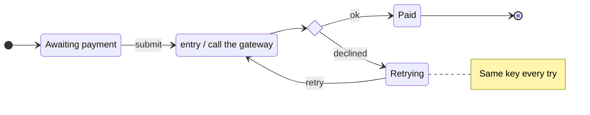
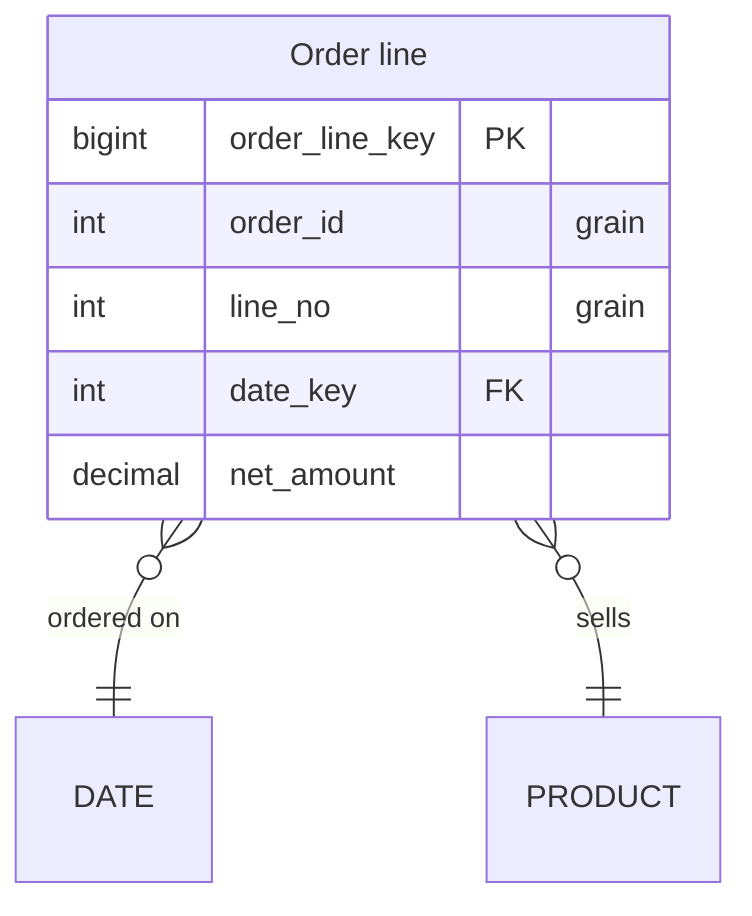

# State diagrams and ER diagrams

Full rules: `../../../docs/map-format.md`, "State diagrams", "ER diagrams", "Walks".

## State diagrams (`stateDiagram-v2`)

How one thing changes over its life (an order, a job, a connection). Drawn as boxes:
states are boxes, composite states hold boxes, transitions are the arrows.

````markdown

````

- `state "Label" as Id` for a readable name; `Id : text` adds a line under the name.
- `[*]` is the start (as a source) or an end (as a target). `<<choice>>`, `<<fork>>`,
  `<<join>>` are the only marks.
- `state X { … }` is a composite state; `--` inside splits it into concurrent regions.
- The checker warns about a state no path reaches and one no transition leaves that is
  not an end: read those, they are often the bug being explained.
- No `click` in a state diagram: link a state to another diagram with a link in its
  note (`[Retry rules](#retry-rules)`).

## ER diagrams (`erDiagram`)

A data model, drawn as tables laid out hub and spoke.

````markdown

````

- Relationships `A <left><line><right> B : label`: `|o` zero or one, `||` exactly one,
  `}o` zero or more, `}|` one or more (mirrored on the right). `--` identifying, `..`
  not. Mermaid's word forms are not read.
- Columns: `type name [PK, FK, UK] ["comment"]`. The comment `"grain"` marks the
  columns that together say what one row is; mark it, readers rely on it.
- Classes `fact`, `dimension`, `bridge` set a table's role; otherwise the viewer infers
  it. Other classes (subject areas) colour the Class scheme.
- Layout is the viewer's; nothing in the map sets it.

## Walks: `## Walks: <name>`

A path told as a story over a state or ER diagram: how an order gets stuck, how a query
joins its tables. After the diagram's block, a step per line:

```
## Walks: Payment fails twice

- [*] --> Pending : The order is placed and waits for payment.
- Pending --> Charging : The shopper submits the card.
- Charging --> check : The gateway answers.
- check --> Retrying : Declined. The order waits and tries again.
```

- A step is a transition of the state diagram, its way round, or a relationship of the
  ER diagram, either way. Each step should start where the last ended.
- In an ER walk, a step onto the many side of a relationship is marked "Rows multiply
  here": use walks to show where a join fans out.
- Play it like a sequence: its `seq` is `<diagram anchor>-walk-<walk name anchor>`,
  where the first diagram's anchor is its `# Title`'s (`# Order states` with the walk
  above: `order-states-walk-payment-fails-twice`):
  `show.py "<map>" --seq order-states-walk-payment-fails-twice --step 1`.

## Column relationships and named join views

Keep Mermaid valid. Put column connections outside its block:

```markdown
## Relations
- ORDER.customer_id order-customer@}o--|| CUSTOMER.id : placed by
- PAYMENT.order_id payment-order@}o--|| ORDER.id : pays

## Joins: Payment by customer
- order-customer
- payment-order

## Joins: Attempts and shipments
- PAYMENT.order_id payment-shipment@--- SHIPMENT.order_id : same order

## Walks: Follow payment | Payment by customer
- PAYMENT payment-order@--> ORDER : Follow the declared relationship.
- ORDER order-customer@--> CUSTOMER : Find the customer.
```

Declare all tables and columns in Mermaid. `TABLE.(a,b)` pairs with `TABLE.(x,y)`
by position. Relationship operators carry ER cardinality; join-only definitions use
`---` and do not create model relationships. IDs are unique per diagram; reuse one as
`- id` in another join view. Notes use existing `### <a id="id"></a>Title` anchors.
No SQL or LEFT/RIGHT direction is required for these equality diagrams.

Up to 15 columns all show with no expand control. Above 15, PK, grain, FK and connected
columns always show. Every mapped endpoint aligns with its column, including separate
relationships between the same tables. Give walk steps explicit IDs when table pairs
are ambiguous: the checker rejects ambiguous, missing or out-of-view selections.
